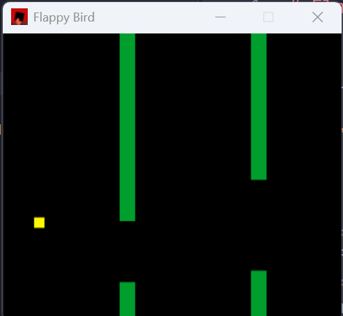

# Flappy Bird

This is a flappy bird clone that I made in Rust so that I could get more experience with low level languages. It includes W/space bar for upward movement, physics, and pipe animation. 
It also prints the current score to the console. I built it primarily using the Rust macroquad library.

## Prerequisites

Make sure you have the Rust toolchain installed on your computer.

1. **Install Rust & Cargo**
   If you don't have Rust installed, run the following command in your terminal or visit [rustup.rs](https://rustup.rs):
2. **System Dependencies (Linux Only):**
   Macroquad requires certain graphics libraries to compile natively on Linux. If you are on Ubuntu/Debian, install them via:
   ```bash
   sudo apt status || sudo apt update
   sudo apt install pkg-config libx11-dev libxi-dev libgl1-mesa-dev libasound2-dev
   ```  

## Building & Running
1. Clone this repository
```bash
git clone https://github.com/m-chen-dev/flappy-bird/
cd flappy-bird
```
2. Run in release or development mode:
* **Release**
  ```bash
  cargo run --release
  ```
* **Development**
  ```bash
  cargo run
  ```

## Controls (if you missed it)
**W/space**: flap upwards or jump

## Preview
